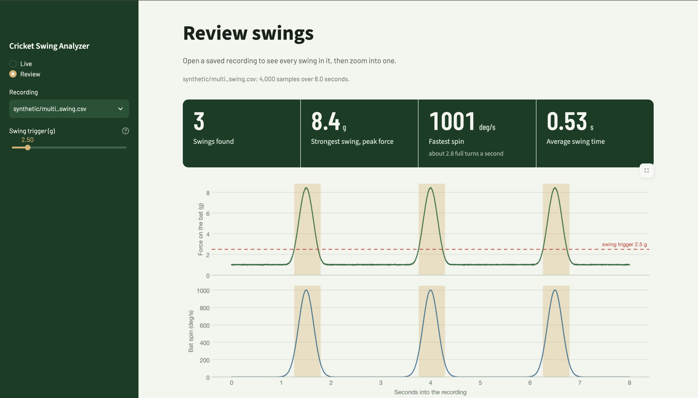
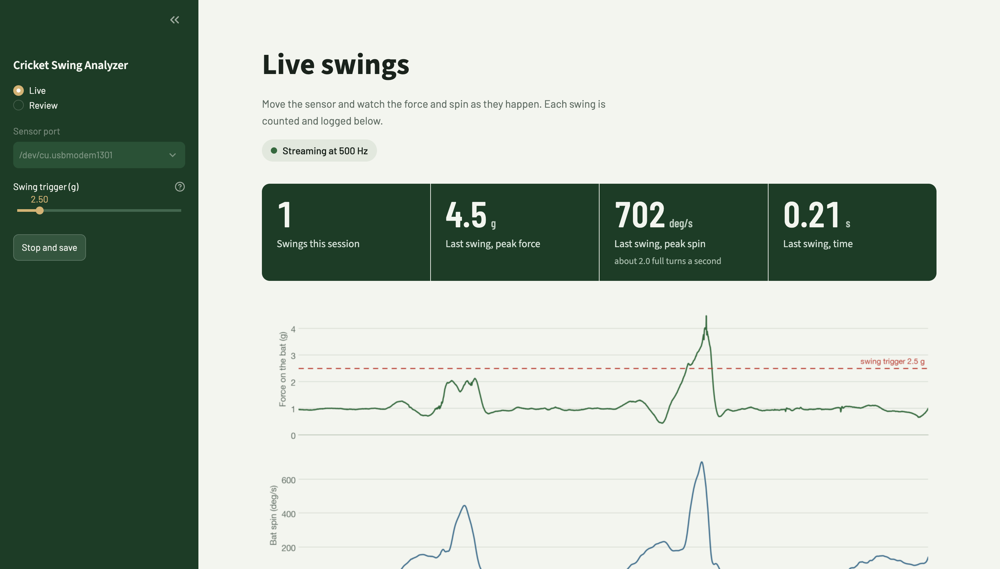
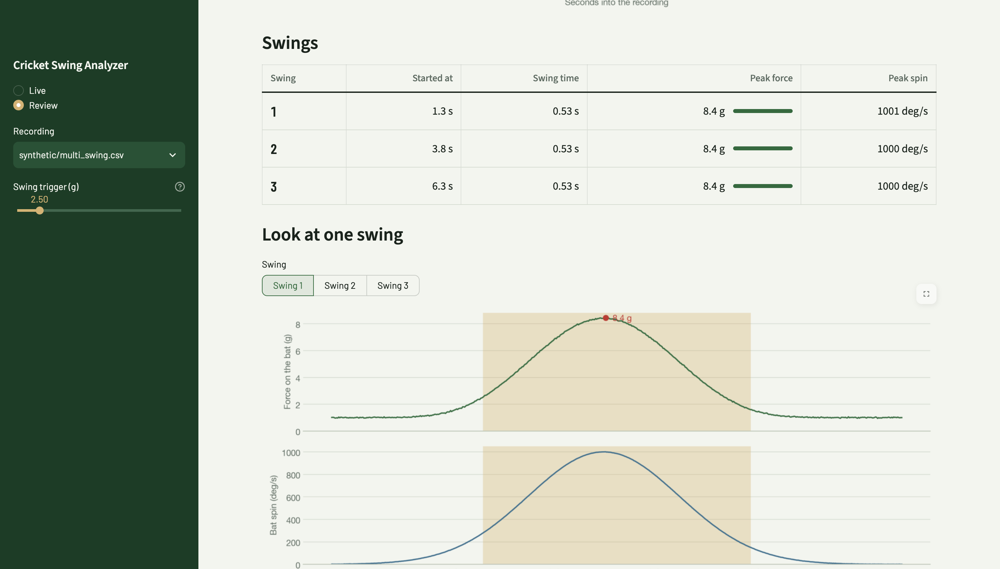

# Cricket Bat Swing & Impact Analyzer

**Embedded Systems | Raspberry Pi Pico 2 W | MPU6050 | Arduino | Python | Streamlit | KiCad**

A sensor on a cricket bat, and software that turns its motion into swings you can see. A Raspberry Pi Pico 2 W reads an MPU6050 motion sensor 500 times a second, and a Python dashboard detects each swing and shows how hard and how fast the bat moved, live or from a saved recording.







## What it does

- **Reads the sensor:** the firmware samples 3-axis acceleration and 3-axis rotation at a **500 Hz** target (±16 g, ±2000 deg/s) and streams them over USB.
- **Records and checks the data:** the Python loader validates every recording (columns, sample rate, gaps, timestamps, sensor limits) and explains problems in plain language.
- **Finds the swings:** a swing is counted once, even though a real swing has several separate acceleration spikes inside it.
- **Shows it clearly:** a dashboard with a **Live** page (force and spin as you swing, with a log of each swing) and a **Review** page (open a recording, see every swing, zoom into one).

## How it works

```text
 Pico 2 W (C++ firmware)                      Computer (Python)
 ─────────────────────────                    ──────────────────────────────────────
 MPU6050 over I²C, every 2 ms
 prints one CSV line per sample ── USB ──►   live.py      reads the serial port, saves a CSV
                                                ▼
                                              ingest.py    load_csv(): validates and cleans
                                                ▼
                                              swings.py    SwingTracker: finds each swing
                                                ▼
                                              dashboard.py Streamlit pages (ui.py = look and feel)
```

The firmware and the Python never call each other. They only agree on the text format of each line (below).

### Why one swing counts once

A bat swing is one smooth sweep of rotation, but the acceleration has several spikes inside it: the hands speeding the bat up, a peak around contact, and the sudden stop in the follow-through, with dips in between. Counting every spike would count one swing three times.

`SwingTracker` (in `python/swings.py`) treats a swing as active while the force is high **or** the bat is still rotating faster than 150 deg/s. It ends the swing only after things stay calm for 0.2 s, and then ignores new swings for 1 s (a batter cannot swing again that fast). The same tracker runs in the live view and on saved recordings, so both always agree.

## Quick start (no hardware needed)

The repository includes synthetic sample recordings, so you can try the dashboard without a sensor.

```bash
git clone https://github.com/nayan-kasireddi/Cricket-Swing-Analyzer.git
cd Cricket-Swing-Analyzer
python -m venv .venv
source .venv/bin/activate          # Windows: .venv\Scripts\activate
pip install -r requirements.txt

python -m streamlit run python/dashboard.py
```

Run it from the project's top folder so Streamlit finds `.streamlit/config.toml`. The **Review** page opens on `synthetic/multi_swing.csv`: three swings, with a scoreboard, charts and a swing table.

Other commands:

```bash
python -m pytest -q                       # run the automated tests
python -m python.live --sim               # live graph with a fake sensor
python -m python.analyze data/synthetic/multi_swing.csv   # static plots from a recording
python -m python.generate_test_data       # regenerate the synthetic recordings
```

Developed on Python 3.14, and Python 3.12 has also been validated. Package versions are not pinned in `requirements.txt`, so a newer release of a library could behave differently.

## Using the real sensor

1. **Wire the sensor** (below) and **upload the firmware** `firmware/pico2w_mpu6050/pico2w_mpu6050.ino` with the Arduino IDE and the Arduino-Pico board package. Hold **BOOTSEL** while plugging the Pico in for the first upload.
2. **Plug the Pico into your computer** with a data USB cable, close the Arduino Serial Monitor (it locks the port), and start the dashboard.
3. On the **Live** page, pick the sensor port, click **Start live view**, and move the sensor. Each swing appears in the log. Click **Stop and save** and the session is stored in `data/live/` (these files are git-ignored), ready to open on the **Review** page.

The live view needs the sensor plugged into the same computer that runs the dashboard. If the Pico is unplugged from power while running, replug it so the firmware sets the sensor up again.

## Hardware

| Component | Purpose |
|---|---|
| Raspberry Pi Pico 2 W | Main microcontroller |
| MPU6050 (GY-521) | 6-axis accelerometer and gyroscope |
| Breadboard and jumper wires | Prototyping |
| USB cable (data-capable) | Power, programming and serial data |
| Custom PCB (in progress) | Compact version for mounting on a bat |

| MPU6050 | Raspberry Pi Pico 2 W |
|---|---|
| VCC | 3V3 (Pin 36) |
| GND | GND (Pin 38) |
| SDA | GP4 (Pin 6) |
| SCL | GP5 (Pin 7) |

The sensor communicates over I²C at address `0x68`.

## Firmware

**Location:** `firmware/pico2w_mpu6050/pico2w_mpu6050.ino` (C++, Arduino)

- Configures the MPU6050 for ±16 g and ±2000 deg/s, and checks the sensor configuration at start-up
- Reads the sensor over I²C at 400 kHz and converts raw values to g and deg/s
- Polls on a fixed 2000 µs schedule (a 500 Hz target) and counts any missed slots in `skipped_slots`
- Streams one line per sample at 115200 baud, with start-up and error diagnostics as `#` comment lines

The other sketches in `firmware/` are earlier bring-up tests (LED and button checks).

## Data format

Each line the firmware sends:

```csv
time_us,ax_g,ay_g,az_g,gx_dps,gy_dps,gz_dps,skipped_slots
94754100,0.1135,-0.0537,1.0270,-0.55,1.69,0.78,0
```

| Field | Description | Unit |
|---|---|---|
| time_us | Time since the board powered on | Microseconds |
| ax_g, ay_g, az_g | Acceleration along X, Y, Z | g |
| gx_dps, gy_dps, gz_dps | Rotation around X, Y, Z | Degrees/second |
| skipped_slots | Sample slots missed so far | Count |

Lines starting with `#` (a startup banner and sensor error notes) are ignored. A sensor lying still reads about 1 g on one axis, which is gravity.

A 500 Hz target is not a guarantee that every sample arrives on time, so check `skipped_slots` and the sample rate in recordings. `load_csv()` flags recordings with gaps or the wrong rate.

`load_csv()` also accepts the simpler `time,ax,ay,az,gx,gy,gz` form with time in seconds, which the synthetic recordings use.

## Python modules

| File | What it does |
|---|---|
| `python/ingest.py` | `load_csv()`: loads a recording, converts units, and checks it (columns, 500 Hz rate, gaps, increasing timestamps, plausible ranges) |
| `python/swings.py` | `SwingTracker`, `detect_swings()`, `summarize_swings()` |
| `python/analyze.py` | Acceleration and rotation magnitude, static plots from the command line |
| `python/live.py` | Reads the serial port on a background thread, saves a CSV, logs swings |
| `python/dashboard.py` | The Streamlit app (Live and Review pages) |
| `python/ui.py` | Colors, styling and HTML pieces for the dashboard |
| `python/generate_test_data.py` | Makes the synthetic recordings (stationary, slow, normal and multi-swing) |
| `python/core.py` | Placeholder for an alternative analysis implementation, not used |
| `python/tests/` | Automated tests |

## Current status and limits

This is a working prototype, and it has not yet seen real bat swings.

- **Tuned on synthetic data and hand movements.** The swing trigger (about 1.5 to 2.5 g in testing) and the 150 deg/s rotation hold are provisional. They need retuning on recordings from a sensor mounted on a bat.
- **Sensor range:** at ±16 g and ±2000 deg/s, a hard hit with the sensor far from the hands could exceed the accelerometer's range. The Review page warns when a recording reaches the sensor's limits.
- **Not built yet:** impact (bat-ball contact) detection, swing-type classification, wireless transmission, and estimated bat speed. These need real swing data first.
- **The live view is local:** it only works when the dashboard runs on the computer the sensor is plugged into.

## Development progress

| Milestone | Status |
|---|---|
| Repository setup and documentation | Complete |
| Pico 2 W firmware upload and LED testing | Complete |
| MPU6050 wiring and soldering | Complete |
| I²C sensor detection | Complete |
| Accelerometer and gyroscope streaming | Complete |
| 500 Hz firmware implementation | Complete |
| CSV loading and data validation | Complete |
| Swing detection (counted once per swing) | Complete |
| Live view and recording | Complete |
| Dashboard with Live and Review pages | Complete |
| Automated tests (40+) | Complete |
| Controlled swing data collection on a bat | Upcoming |
| Threshold tuning on real swings | Upcoming |
| Impact detection | Planned |
| Swing-type classification | Planned |
| KiCad schematic and PCB layout | In progress |
| PCB fabrication and assembly | Planned |
| Final demonstration | Planned |

See [`docs/devlog.md`](docs/devlog.md) and [`docs/shayon_chakraborti_devlog.md`](docs/shayon_chakraborti_devlog.md) for detailed updates.

## Project structure

```text
Cricket-Swing-Analyzer/
├── .streamlit/
│   └── config.toml            # dashboard theme
├── firmware/
│   └── pico2w_mpu6050/
│       └── pico2w_mpu6050.ino
├── hardware/
├── python/
│   ├── tests/
│   ├── analyze.py
│   ├── core.py
│   ├── dashboard.py
│   ├── generate_test_data.py
│   ├── ingest.py
│   ├── live.py
│   ├── swings.py
│   └── ui.py
├── data/
│   ├── synthetic/             # generated sample recordings
│   └── live/                  # your recordings (git-ignored)
├── docs/
├── images/
├── README.md
└── requirements.txt
```

## Troubleshooting

| Issue | Suggested solution |
|---|---|
| No sensor port on the Live page | Use a data-capable USB cable, replug the Pico, and refresh the page |
| "Port busy" or cannot open the port | Close the Arduino Serial Monitor or any other program using it |
| Live data stops or looks wrong after a loose wire | Unplug and replug the Pico so the firmware sets the sensor up again |
| A recording will not open: gap or sample rate error | The recording is missing samples or came from older 100 Hz firmware. Record again |
| MPU6050 not detected | Check wiring, solder joints, and I²C address `0x68` |
| Firmware upload fails | Hold BOOTSEL while plugging in the Pico, and confirm the board selection |

## Authors

**Nayan Kasireddi** — hardware, firmware, and PCB design
Electrical and Computer Engineering, The University of Texas at Austin
GitHub: [@nayan-kasireddi](https://github.com/nayan-kasireddi)

**Shayon Chakraborti** — Python data pipeline, swing detection, and dashboard
Statistics and Data Science, The University of Texas at Austin
GitHub: [@Shayon2307](https://github.com/Shayon2307)

## Acknowledgments

Built with the Raspberry Pi Pico platform, the MPU6050 motion sensor, Arduino, Python (NumPy, pandas, Matplotlib, Streamlit, pySerial), and KiCad. Hardware prototyping and fabrication resources are available through Texas Inventionworks at The University of Texas at Austin.

## Project resources

- [GitHub repository](https://github.com/nayan-kasireddi/Cricket-Swing-Analyzer)
- [Firmware](firmware/pico2w_mpu6050/pico2w_mpu6050.ino)
- [Development logs](docs/)
- [Python code](python/)